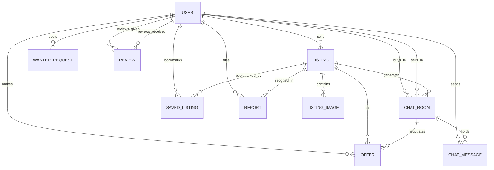

# Buy & Sell — Complete Application Specification

## 1. Executive Summary & Vision

**Buy & Sell** is a hyper-local, zero-commission peer-to-peer web marketplace engineered specifically for college and university campuses. It addresses key frictions in university commerce:
* **Trust & Safety**: Restricted to authenticated institutional domain emails (`.ac.in`, `.edu`, `techuni.ac.in`).
* **Designated Safe Zones**: Pre-configured physical campus meetup points (e.g. Central Library Foyer, Student Activity Center, Hall lobbies) with recommended hours and security coverage.
* **Fair Pricing & Zero Commission**: Peer-to-peer cash or UPI handoffs without platform cuts.
* **Campus-Centric Features**: Academic coursebook pass-down, dorm furniture transfers, scientific calculator rentals, free senior giveaways, and a **Wanted Board** for student requests.
* **Real-time In-App Bargaining**: Server-Sent Events (SSE) streaming chat with integrated price counter-offers, acceptance locks, and mutual post-handover reviews.

---

## 2. Technology Stack & Architectural Principles

| Layer | Technology | Rationale & Specifications |
|---|---|---|
| **Framework** | Next.js 16 (App Router with Turbopack) | Server Components, Route Handlers, fast streaming & static prerendering |
| **UI Library** | React 19 & TypeScript | Strictly-typed component interfaces and modern React hooks |
| **Styling** | Vanilla CSS (`src/app/globals.css`) | Distinctive tactile "notebook sketchbook" aesthetic with wobbly graphite borders and drop shadows |
| **Icons** | Lucide React | Consistent, lightweight vector glyphs |
| **Database** | SQLite via Prisma ORM (`prisma/schema.prisma`) | Zero-config portable database with relational constraints & cascade deletes |
| **Authentication** | Custom Stateless JWT (`jose`) + `bcryptjs` | HttpOnly cookies (`buy_and_sell_session`), institutional email verification & OTP mode |
| **Real-Time Engine**| Server-Sent Events (SSE) via Web Streams | Low-latency message push over HTTP without requiring heavy external WebSocket brokers |
| **Storage** | Local File Storage (`src/lib/storage.ts`) | Multipart upload route saving to `public/uploads` with crypto-randomized filenames |

---

## 3. Configuration Architecture & Single Source of Truth

All campus-wide variables, safe zones, allowed domains, currency symbols, and business taxonomies are centralized in:
> **[`src/config/marketplace.config.ts`](file:///home/priyanshu-pareek/internship-projects/buy-and-sell-website/src/config/marketplace.config.ts)**

### Configured Elements:
1. **Institution Details**: Campus Name (`TechUni Buy & Sell`), Short Name (`TechUni`), Support Email.
2. **Currency**: Symbol (`₹`), Code (`INR`).
3. **Allowed Domains**: `['ac.in', 'edu', 'techuni.ac.in', 'campus.edu', 'student.techuni.ac.in']`.
4. **Campus Safe Meetup Spots**:
   * Central Library Foyer
   * Student Activity Center (SAC)
   * Campus Central Cafeteria
   * Hall 2 Cycle Stand & Gate
   * Hall 4 Common Room Lobby
   * Hall 7 (Gargi) Reception Desk
   * Science Complex Entrance Quadrangle
   * Campus Sports Complex / Gymnasium
   * Admin Building Quadrangle
5. **Categories**:
   * Textbooks
   * Electronics
   * Dorm Essentials
   * Cycles & Transport
   * Fashion & Sports
   * Free / Giveaway
6. **Conditions**: Brand New, Like New, Good, Fair.
7. **Urgency Levels**: LOW, NORMAL, URGENT.
8. **Listing Statuses**: ACTIVE, RESERVED, SOLD, ARCHIVED.
9. **Report Reasons**: Prohibited Item on Campus, Suspected Counterfeit or Scam, No-show / Fake Listing, Inappropriate or Harassing Content, Duplicate / Spam Listing, Other Campus Policy Violation.
10. **Upload Parameters**: 8MB maximum file size, image MIME types (JPEG, PNG, WebP).

---

## 4. Database Schema & Data Models

The Prisma relational schema defines 10 core entities:

### Entity Specifications

#### 1. `User`
* `id` (String, UUID, PK)
* `email` (String, unique): Must match institutional domain whitelist.
* `name` (String): Full student name.
* `passwordHash` (String, optional for OTP users)
* `avatarUrl` (String, optional)
* `department` (String, optional e.g. "Computer Science & Engineering")
* `graduationYear` (Int, optional e.g. 2026)
* `hostelBlock` (String, optional e.g. "Hall 4, Wing-B, Room 302")
* `phone` (String, optional)
* `isEmailVerified` (Boolean, default: false)
* `role` (String, default: "STUDENT", enum: "STUDENT" | "ADMIN")

#### 2. `Listing`
* `id` (String, UUID, PK)
* `title` (String), `description` (String)
* `category` (String): References standard category IDs.
* `condition` (String): "Brand New" | "Like New" | "Good" | "Fair"
* `price` (Float): In Indian Rupees (₹). 0 for giveaways.
* `isNegotiable` (Boolean), `isGiveaway` (Boolean)
* `meetupLocation` (String): Pre-validated campus safe spot.
* `status` (String, default: "ACTIVE"): "ACTIVE" | "RESERVED" | "SOLD" | "ARCHIVED"
* `viewCount` (Int, default: 0)
* `sellerId` (String, FK -> User.id)

#### 3. `ListingImage`
* `id` (String, UUID, PK)
* `listingId` (String, FK -> Listing.id, Cascade Delete)
* `url` (String): Relative web path (e.g. `/uploads/...`) or external URL.
* `order` (Int, default: 0)

#### 4. `SavedListing`
* `id` (String, UUID, PK)
* `userId` (String, FK -> User.id, Cascade Delete)
* `listingId` (String, FK -> Listing.id, Cascade Delete)
* Unique Constraint: `[userId, listingId]` prevents duplicate bookmarks.

#### 5. `WantedRequest`
* `id` (String, UUID, PK)
* `title` (String), `description` (String), `category` (String)
* `targetBudget` (Float, optional): Target price in ₹.
* `urgency` (String, default: "NORMAL"): "LOW" | "NORMAL" | "URGENT"
* `status` (String, default: "OPEN"): "OPEN" | "FULFILLED" | "CLOSED"
* `userId` (String, FK -> User.id)

#### 6. `ChatRoom`
* `id` (String, UUID, PK)
* `listingId` (String, FK -> Listing.id)
* `buyerId` (String, FK -> User.id)
* `sellerId` (String, FK -> User.id)
* `lastMessageAt` (DateTime)
* Unique Constraint: `[listingId, buyerId]` guarantees one direct thread per buyer/listing.

#### 7. `ChatMessage`
* `id` (String, UUID, PK)
* `chatRoomId` (String, FK -> ChatRoom.id)
* `senderId` (String, FK -> User.id)
* `content` (String)
* `messageType` (String): "TEXT" | "OFFER_PROPOSAL" | "OFFER_ACCEPTED" | "SYSTEM"
* `isRead` (Boolean, default: false)

#### 8. `Offer`
* `id` (String, UUID, PK)
* `chatRoomId` (String, FK -> ChatRoom.id)
* `listingId` (String, FK -> Listing.id)
* `buyerId` (String, FK -> User.id)
* `amount` (Float): Proposed price in ₹.
* `status` (String): "PENDING" | "ACCEPTED" | "DECLINED" | "COUNTERED" | "EXPIRED"

#### 9. `Review`
* `id` (String, UUID, PK)
* `rating` (Int, 1 to 5)
* `comment` (String, optional)
* `tags` (String, optional comma-delimited e.g. "Prompt meetup,Honest description")
* `reviewerId` (String, FK -> User.id)
* `targetId` (String, FK -> User.id)

#### 10. `Report`
* `id` (String, UUID, PK)
* `reporterId` (String, FK -> User.id)
* `listingId` (String, optional, FK -> Listing.id)
* `reason` (String), `details` (String, optional)
* `status` (String): "PENDING" | "RESOLVED" | "DISMISSED"

---

## 5. API Routes & Endpoint Reference

### Authentication (`/api/auth/*`)
* `POST /api/auth/register`: Create user account with validated institutional email.
* `POST /api/auth/login`: Email/password authentication, sets session cookie.
* `POST /api/auth/otp`:
  * `{ action: "send", email }`: Generates and logs/sends a 6-digit numeric OTP code.
  * `{ action: "verify", email, otp }`: Validates OTP and issues session cookie.
* `GET /api/auth/me`: Returns current user session payload and unread chat message counter.
* `POST /api/auth/logout`: Clears session cookie.

### Marketplace Listings (`/api/listings/*`)
* `GET /api/listings`: Filter and search feed.
  * Query params: `q`, `category`, `condition`, `minPrice`, `maxPrice`, `isGiveaway`, `status`, `sort`.
* `POST /api/listings`: Create new item listing (requires authenticated session).
* `GET /api/listings/[id]`: Detailed listing page info, seller trust ratings, and `isSaved` status for user.
* `PATCH /api/listings/[id]`: Update listing status (`ACTIVE`, `RESERVED`, `SOLD`) or fields (owner only).
* `DELETE /api/listings/[id]`: Delete listing (owner only).
* `POST /api/listings/[id]/save`: Toggles bookmark for the current user. Returns `{ saved: boolean }`.
* `GET /api/listings/[id]/save`: Checks if current user bookmarked the listing.
* `GET /api/listings/saved`: Returns array of all saved listings bookmarked by the current user.

### Chat & Real-Time SSE (`/api/chat/*`)
* `GET /api/chat/rooms`: List conversation threads for logged-in user with latest messages.
* `POST /api/chat/rooms`: Initiate conversation thread for a given `listingId`.
* `GET /api/chat/[roomId]/messages`: Fetch message history and listing metadata for a thread.
* `POST /api/chat/[roomId]/messages`: Send a message into the thread.
* `GET /api/chat/[roomId]/stream`: Server-Sent Events stream delivering new messages in real time with keep-alive heartbeat.

### Price Offers & Bargaining (`/api/offers`)
* `POST /api/offers`: Buyer submits a monetary offer proposal. Automatically posts an `OFFER_PROPOSAL` message into the thread.
* `PATCH /api/offers`: Seller accepts or declines offer. On acceptance:
  * Listing status automatically moves to `RESERVED`.
  * An `OFFER_ACCEPTED` banner message is published to the chat thread.

### Campus Wanted Board (`/api/wanted`)
* `GET /api/wanted`: List open student requests with urgency and budget badges.
* `POST /api/wanted`: Create wanted item request.

### Peer Reviews & Reputation (`/api/reviews`)
* `GET /api/reviews?targetId=<id>`: Fetch all reviews and calculate average rating for a student.
* `POST /api/reviews`: Submit 1–5 star rating and comment after a completed transaction.

### Moderation & Incident Reports (`/api/reports`)
* `GET /api/reports`: Admin view of all filed reports with listing and reporter details.
* `POST /api/reports`: Student reports a listing for safety violations.
* `PATCH /api/reports`: Admin resolves report and optionally deletes the reported listing.

---

## 6. Real-Time Chat Engine & Scroll Mechanics

### The Upward Scrolling Architecture
In real-time chat applications, auto-scrolling can degrade user experience if it forces the viewport down while a user is reading older messages. The chat hub resolves this through a multi-tier scroll controller:
1. **Bounded Scrollport**: The container uses strict flexbox bounds (`min-height: 0; overflow-y: auto`) inside a fixed-height parent grid cell, preventing content overflow from expanding the parent element.
2. **Scroll Distance Detection**: An `onScroll` event listener measures `scrollHeight - scrollTop - clientHeight`. If distance to bottom is under 80px, `isNearBottomRef` is flagged `true`.
3. **Conditional Auto-Scroll**:
   * On initial room load: Instantly scrolls to bottom.
   * On outbound message: Smoothly scrolls to bottom.
   * On incoming SSE message: Only scrolls down if `isNearBottomRef` was already `true`. If the user has scrolled up, their reading position is preserved uninterrupted.
4. **Quick-Return Trigger**: When scrolled up, a floating **"Scroll to latest ↓"** badge appears, allowing one-click return to the newest messages.

---

## 7. Security & Privacy Guarantees

1. **Email Domain Filtering**: Enforced on registration and OTP request via `isInstitutionalEmail()`.
2. **Safe Meetup Enforcement**: Every listing requires choosing from a verified campus safe spot.
3. **Session Cookies**:
   * Signed with HS256 JWT.
   * HttpOnly prevents XSS token theft.
   * SameSite=Lax defends against CSRF attacks.
4. **Input Sanitization & Limits**:
   * File uploads capped at 8MB.
   * MIME type restrictions (`image/jpeg`, `image/png`, `image/webp`).
   * Crypto-randomized filenames prevent path traversal.
